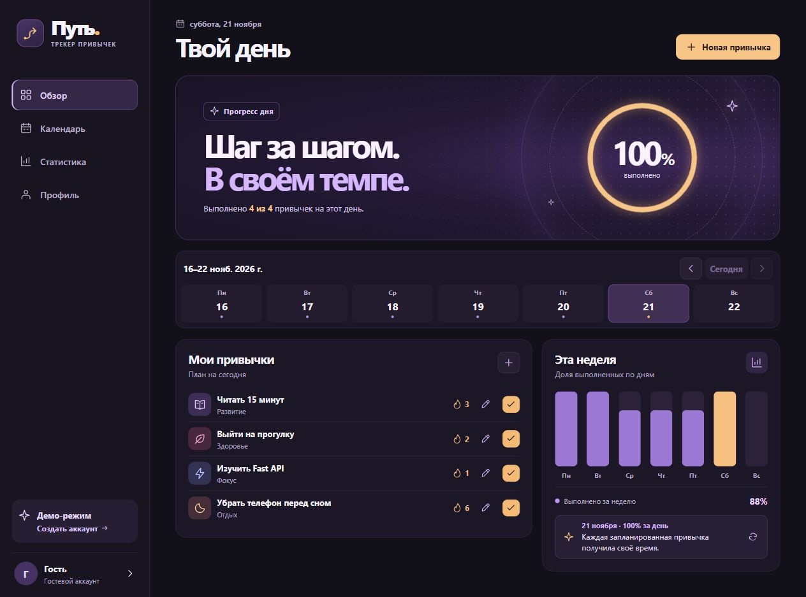

# Путь · Habit Tracker

«Путь» — fullstack-трекер привычек на **FastAPI, SQLite, React и TypeScript**. В демо сразу доступны четыре привычки с историей отметок. В личном аккаунте можно составить своё расписание и сохранять прогресс между входами.

[Открыть демо «Путь»](https://zxcharm.pythonanywhere.com/)

[Открыть бота в Telegram](https://t.me/zxcharm_habit_tracker_bot)



## Возможности

- Привычки с собственными категориями и расписанием по дням недели.
- Отметки по датам, включая прошедшие дни, и подсчёт серий выполнения.
- Недельный обзор, календарь активности, статистика за неделю и месяц.
- Дневные фразы по результатам, личный кабинет и адаптивная тёмная тема.

## Запуск из чистой копии

Понадобятся Git, Python 3.13 или 3.14 и Node.js 24 или новее. Команды для PowerShell:

```powershell
git clone https://github.com/zxcharm/habit-tracker.git
cd habit-tracker
python -m venv .venv
.\.venv\Scripts\python.exe -m pip install -r requirements.txt
npm.cmd install --prefix frontend
npm.cmd run build --prefix frontend
.\.venv\Scripts\python.exe -m uvicorn main:app --reload
```

После запуска открой [приложение](http://127.0.0.1:8000/), [Swagger UI](http://127.0.0.1:8000/docs) или [проверку сервера](http://127.0.0.1:8000/health). Для запросов к закрытым маршрутам через Swagger сначала открой демо или войди в приложение по тому же адресу.

Если Python доступен через `py`, создай окружение командой `py -m venv .venv`. SQLite создаст файл `data/habits.sqlite3` при запуске. Другой путь можно указать в переменной окружения `HABIT_DB_PATH`.

При работе над интерфейсом запусти `npm.cmd run dev --prefix frontend` во втором терминале, оставив FastAPI запущенным. Открой [Vite](http://127.0.0.1:5173/). Он обновляет интерфейс при сохранении исходников и передаёт запросы `/api` в FastAPI.

## Как проверить вручную

| Сценарий | Что должно произойти |
| --- | --- |
| Открыть приложение в новом окне инкогнито | Появится демо с четырьмя привычками, двумя отметками и кольцом прогресса на 50%. |
| Отметить «Изучить Fast API» и обновить страницу | Прогресс станет 75%, а отметка сохранится после обновления. Повторное нажатие снимет её. |
| Создать привычку, выбрать дни недели и открыть календарь | Отметка будет доступна в дни из расписания, в том числе до даты создания привычки. |
| В форме привычки нажать «Своя категория», ввести название и сохранить привычку | Новая категория выберется автоматически. После перезагрузки она останется доступна в этом аккаунте. |
| Выбрать прошедший день в календаре демо и изменить отметку | Изменятся ячейка календаря и агрегаты за соответствующий период. Для будущего дня кнопка отметки недоступна. |
| На «Обзоре» нажать стрелку предыдущей недели, выбрать день и нажать «Сегодня» | Даты и график переключаются вместе. «Сегодня» возвращает к текущему дню. |
| Выбрать день на «Обзоре» и нажать ↻ под графиком | Фраза опирается на выполнение за выбранную дату. Кнопка перебирает пять вариантов для текущего диапазона. |
| Открыть статистику и выбрать другой месяц | Меняется отчёт за месяц. Недельный график остаётся привязан к текущей неделе. |
| Зарегистрироваться, создать привычку, выйти и войти снова | В личном аккаунте сначала пусто. После повторного входа созданная привычка появится снова. |
| Открыть редактор привычки и удалить её | Приложение попросит подтвердить удаление. После подтверждения привычка и её отметки исчезнут. |
| Сузить окно до размеров телефона | Навигация переместится вниз, а карточки выстроятся в колонку. |

## Что где находится

| Файл или папка | Ответственность |
| --- | --- |
| `main.py` | Создаёт приложение, подключает API и отдаёт готовую сборку интерфейса. |
| `tracker/api.py` | HTTP-маршруты, модели Pydantic, сценарии аккаунта и привычек. |
| `tracker/storage.py` | Подключение к SQLite, таблицы, транзакции. |
| `tracker/auth.py` | Хеширование паролей, создание и проверка сессий. |
| `tracker/metrics.py` | Расписание, текущие и лучшие серии, агрегирование отметок. |
| `frontend/src/main.tsx` | Навигация, состояние приложения, формы и профиль. |
| `frontend/src/Dashboard.tsx` | Кольцо прогресса, список привычек, график и календарь. |
| `frontend/src/data.ts` | Типы ответа, HTTP-клиент и функции для работы с датами. |
| `frontend/src/styles.css` | Цвета, отступы, отзывчивая сетка и анимации. |
| `tests/` | Тесты API и расчётов на временной базе. |
| `.github/workflows/ci.yml` | Команды для проверки backend и frontend в GitHub Actions. |

Неделя начинается в понедельник. Дни вне расписания не прерывают серию. До конца текущего дня серия остаётся открытой. Если поставить отметку до даты создания привычки, расчёт серий и статистики начнётся с самой ранней отметки. При редактировании расписания прошлые плановые дни пересчитываются по новому расписанию, а сделанные отметки сохраняются. Демо выдаёт каждому браузеру отдельную гостевую сессию на 24 часа. Личный аккаунт начинается с пустого списка.

## Автоматические проверки

```powershell
.\.venv\Scripts\python.exe -m pip install -r requirements-dev.txt
.\.venv\Scripts\python.exe -m unittest discover -s tests -v
npm.cmd run check --prefix frontend
npm.cmd run build --prefix frontend
```

## Хранение и запуск на сервере

Для бесплатного портфолио подготовлен [запуск на PythonAnywhere](deploy/PYTHONANYWHERE.md). Сервер хранит базу отдельно от кода, включает защищённые cookie на HTTPS и ограничивает частоту входа, регистрации и создания демо-сессий.
